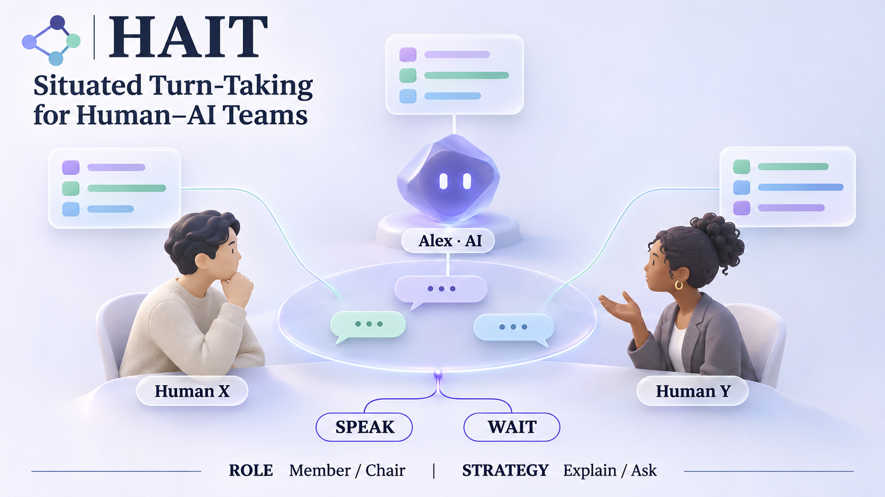
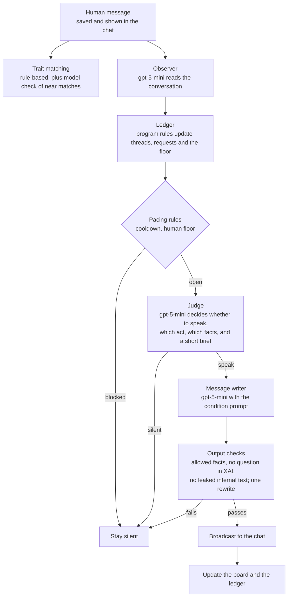

<h1 align="center">HAIT: Situated Turn-Taking for Human–AI Teams</h1>

<p align="center">
  Experimental platform for<br/>
  <b><i>AI Role and Communication Strategy in Group Decision Making with Distributed Information</i></b><br/>
  Sumin Kim · Master's thesis · University of Michigan–Dearborn · 2026
</p>

<p align="center">
  
  
  
  
  <a href="LICENSE"></a>
</p>

<p align="center">
  
</p>

HAIT runs a live three-way text chat between two human participants and an AI
participant, **Alex**. The team chooses an airline captain from four candidates
in a *hidden profile* task: each member's card holds only part of the
information, and the best candidate becomes clear only when the cards are
pooled. The platform varies Alex's **role** (Member or Chair) and
**communication strategy** (explain or ask), and decides on every turn whether
Alex should speak or wait.

## Contents

- [Study Design](#study-design)
- [How Alex Decides](#how-alex-decides)
- [Installation](#installation)
- [Running a Session](#running-a-session)
- [Data](#data)
- [Tests and Evaluation](#tests-and-evaluation)
- [Repository Structure](#repository-structure)
- [Citation](#citation)

## Study Design

A 2 × 2 between-team design crosses Alex's role with its communication
strategy, plus a three-human control.

| Condition | AI role | Strategy | Code label        |
| --------- | ------- | -------- | ----------------- |
| C1        | Member  | XAI      | `peer` / `xai`    |
| C2        | Chair   | XAI      | `leader` / `xai`  |
| C3        | Member  | SAI      | `peer` / `aci`    |
| C4        | Chair   | SAI      | `leader` / `aci`  |
| CTRL      | —       | —        | three humans      |

- **XAI** (explanation-based AI) shares information and explains its reasoning
  in statements; it never asks a question.
- **SAI** (Socratic AI) shares information and draws out what the humans know by
  asking questions. The code calls this strategy `aci` ("inquiry").
- A **Chair** may structure the discussion, mediate, and recap the board. A
  **Member** contributes as an equal.

Alex holds profile **Z**; the humans hold **X** and **Y**. Each card shows 24 of
the 40 traits: 16 shared by all cards and 8 unique to that card. Candidate C is
the best choice once every card is pooled, but looks weakest from the shared
traits alone.

## How Alex Decides

Every human message goes through the same pipeline in every AI condition.



<p align="center"><i>The Observer interprets, program rules keep the
conversation state and pacing, the Judge decides whether and what to say, and
the writer phrases it in the condition's voice.</i></p>

Pacing is identical across conditions: after speaking, Alex waits for two human
messages unless addressed directly. Only the role goal and the writer's prompt
change by condition. See [ARCHITECTURE.md](ARCHITECTURE.md) for the full design
and [CONTEXT.md](CONTEXT.md) for the project vocabulary.

## Installation

Requirements: Node.js 20+, MongoDB, and an API key for an OpenAI-compatible
endpoint (the study used the U-M GPT Toolkit gateway).

```bash
git clone https://github.com/sumin6475/HAIT-system.git
cd HAIT-system

cd server && cp .env.example .env && npm install && cd ..
cd client && cp .env.example .env && npm install && cd ..
```

Fill in the two `.env` files:

| File          | Keys                                                                 |
| ------------- | -------------------------------------------------------------------- |
| `server/.env` | `MONGODB_URI`, `OPENAI_API_KEY`, `OPENAI_API_BASE`, `ADMIN_TOKEN`    |
| `client/.env` | `VITE_SERVER_URL`, `VITE_ADMIN_TOKEN` (same as server), survey URLs  |

## Running a Session

```bash
cd server && npm run dev     # http://localhost:3001
cd client && npm run dev     # http://localhost:8080
```

1. Open the researcher dashboard at `/dashboard` and create a session with a
   condition.
2. Share the participant codes and approve each stage as participants arrive.
3. The team discusses for up to 30 minutes (Exit appears after 12) and submits
   a team choice.

To try a condition without the full study flow, open **Test Harness** in the
dashboard: it shows both participant chats side by side. Consent and surveys
run in Qualtrics; the platform links to them with the participant code and
condition.

Alex's prompts are built from blocks in `server/src/prompts/blocks/`. After
editing them, run `npm run prompts:compile` in `server/`; the server checks
each prompt's hash at start-up and refuses to run a hand-edited compiled file.

## Data

Each session writes to five MongoDB collections.

| Collection                 | One document per                 | Holds                                                          |
| -------------------------- | -------------------------------- | -------------------------------------------------------------- |
| `sessions`                 | session                          | condition, status, team decision, board, Alex's state          |
| `participants`             | participant                      | role, profile, pre-discussion choice, final choice             |
| `messages`                 | chat message                     | sender, text, sequence number, traits put in view              |
| `aiinterventions`          | Alex decision (spoken or silent) | how the decision was reached, its outcome, model call details  |
| `conversationobservations` | human message                    | the Observer's reading and the ledger state after it           |

The study data are not included in this repository. Please contact the author
for access.

## Tests and Evaluation

Offline checks (no network, no database):

```bash
cd server
npm run test:conversation-ledger
npm run test:conversation-recovery
npm run test:pooling-extractor
npx tsc --noEmit

cd ../client
npx vitest run
```

Model test cases call the live model: `npm run observer:cases`,
`npm run judge:cases`, `npm run judge:rules`, `npm run eval:followup`.
Latest results and their limits: [server/src/eval/RESULTS.md](server/src/eval/RESULTS.md).

## Repository Structure

```
client/                 React + Vite: participant screens and researcher dashboard
server/
  src/index.ts          entry point
  src/sockets/          real-time chat
  src/routes/           REST API (sessions, participants, conditions)
  src/models/           MongoDB collections
  src/lib/              Observer, ledger, Judge, message writer, trait matching
  src/prompts/          prompt blocks and the compiled route-prompts.json
  src/eval/             model test cases and RESULTS.md
  src/scripts/          offline tests
assets/                 README images
```

## Citation

```bibtex
@mastersthesis{kim2026hait,
  title  = {AI Role and Communication Strategy in Group Decision Making with Distributed Information},
  author = {Kim, Sumin},
  school = {University of Michigan--Dearborn},
  year   = {2026}
}
```

## License

Released under the [MIT License](LICENSE).
